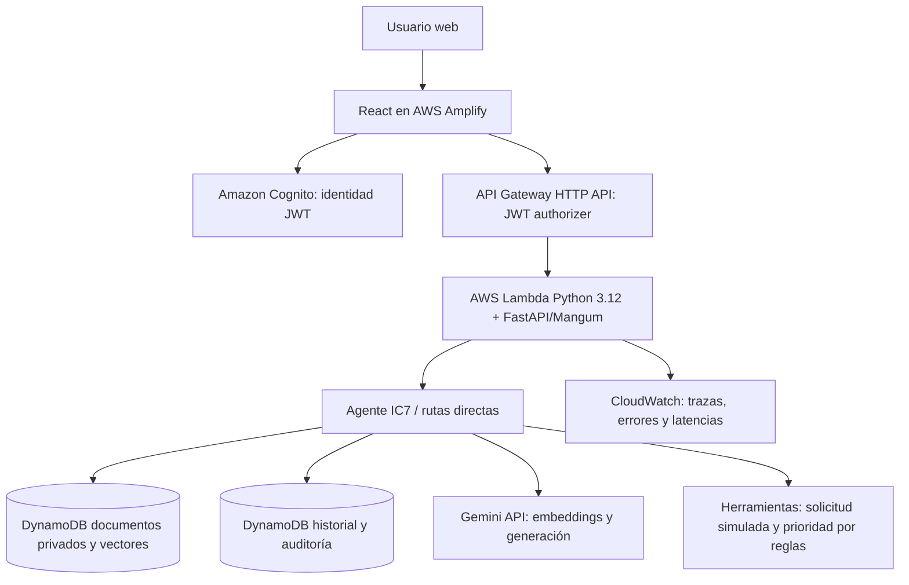
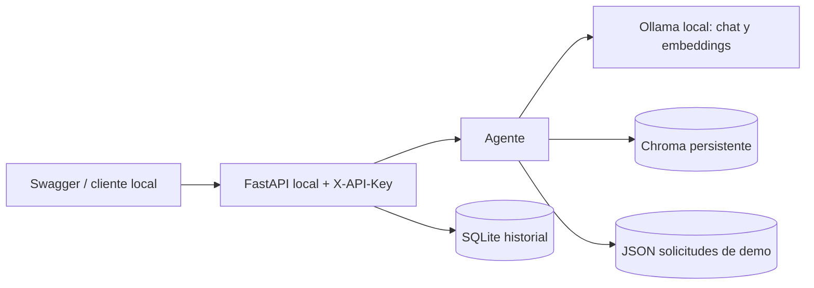

# Arquitectura IC7 — implementación AWS y alternativa local

**Estado:** AWS implementado y probado el 27-10-2026. Este documento reemplaza la antigua descripción «AWS no desplegado».

## Arquitectura AWS (ejecutada)

**Frontend:** `https://main.de7h6ja4dscnj.amplifyapp.com/`. **API:** `https://xwejxdr534.execute-api.us-east-1.amazonaws.com`. **Lambda:** `ic7-enterprise-ai-assistant` (`us-east-1`), Python 3.12, 256 MB, timeout 60 s. **Ruta `/api/ask`:** integración HTTP API con 30.000 ms. **Tablas DynamoDB:** `ic7-demo-docs` y `ic7-demo-audit`. **Proveedor:** Gemini externo (`gemini-embedding-001` para embeddings; `gemini-3.5-flash-lite` registrado en pruebas de generación). Los nombres reflejan el entorno demostrado, no recomendaciones universales.

## Flujos

1. **Ingesta:** JWT verificado; extraer texto TXT/MD/PDF admitido; fragmentar; obtener embeddings; almacenar documentos/vectores bajo partición privada del usuario.
2. **RAG:** pregunta documental inequívoca → embedding de consulta → búsqueda en DynamoDB con filtros de similitud y propietario → hasta cuatro fragmentos de evidencia → Gemini para redactar → comprobar citas `[F#]` → responder con fuentes citadas. Si no hay evidencia relevante, abstenerse.
3. **Herramientas estructuradas:** clasificación explícita de prioridad y consulta inequívoca de `SOL-1001` se resuelven directamente en Python/almacén simulado; otras intenciones usan agente con llamadas a herramientas. Sin escritura ni operaciones remotas arbitrarias.
4. **Historial:** eventos de consulta y conversaciones aislados por identidad verificada de Cognito, con trazas correlacionables en CloudWatch.

## Seguridad y decisiones

- **Identidad:** Cognito JWT; no confiar en un `owner` proporcionado por el cliente. La partición de los documentos privados deriva de la identidad autenticada.
- **Alcance:** pruebas de aislamiento entre dos usuarios se realizaron en la demo; no implican auditoría independiente de seguridad.
- **Fuentes:** el código conserva solo fragmentos efectivamente citados; se rechazan referencias inexistentes y se tratan fragmentos como datos no confiables. No garantiza ausencia total de prompt injection.
- **No servicio vectorial gestionado:** DynamoDB almacena y consulta vectores con búsqueda acotada. Es apropiado para corpus pequeño de demostración, no para grandes volúmenes.
- **Latencia:** ruta documental corta y presupuesto de ejecución menor al timeout de integración. Retrasos externos de Gemini pueden producir HTTP 503.
- **Observabilidad:** registros de operaciones `embedContent`, `generateContent`, duración de recuperación y `trace_id` sin volcar documentos ni claves.

## Alternativa local — no confundir con AWS

La variante local puede ejecutarse con Docker Compose y modelos Ollama; sus controles de autenticación e aislamiento no son equivalentes a los de AWS. Ver README para instalación.

## Riesgos pendientes

| Riesgo | Evidencia/control | Pendiente |
|---|---|---|
| Indisponibilidad Gemini | Timeout controlado y error HTTP 503 observado | Reintentos presupuestados, métricas longitudinales, acuerdos proveedor |
| Groundedness | Abstención, citas válidas, pruebas funcionales | Evaluación humana sobre corpus etiquetado, adversarial amplio |
| Autorización | JWT y aislamiento privado probado | Revisión formal IAM/RBAC, pruebas multitenant extensivas |
| Escalabilidad | RAG documental con pocos archivos | Motor vectorial indexado, carga concurrente y costos |
| Datos | Demo simulada, logs sin contenido sensible | Retención, backups/restauración, cifrado y DLP verificados |
| Costos | Servicios AWS/Gemini activos | Monitoreo de facturación, límites y alertas |
