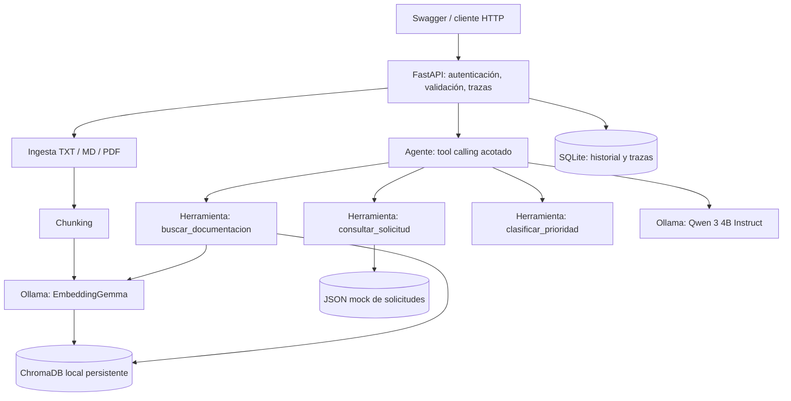

# Arquitectura de referencia (MVP local)

## Alternativa AWS (documentada, no desplegada)

- API Gateway + Lambda para backend ligero; S3 para documentos; DynamoDB para estados, auditoría.
- El vector store local persistente se reemplazaría por un servicio vectorial remoto compatible o una base de datos con extensión vectorial. No asumir que servicios gestionados vectoriales son gratuitos.
- **El LLM local Ollama NO se ejecuta dentro de Lambda**: se reemplazaría por una API de inferencia externa o servicio AWS con facturación. Verificar disponibilidad, costos y privacidad antes de activar.
- Los secretos se guardarían en un gestor adecuado, usando IAM de mínimos privilegios, TLS y separación dev/prod.
- Sin autorización expresa, no se suben documentos corporativos reales a APIs externas con nivel gratuito.
- Para pruebas sin costo, ejecutar local. El despliegue cloud es opcional en el enunciado si se documenta la arquitectura.

## Decisiones arquitectónicas

1. Monolito modular: apropiado para plazo de prueba y volumen reducido; microservicios agregarían costos de operación.
2. Chroma persistente local: consulta vectorial con distancia coseno; no apto para Lambda efímera.
3. Ollama: generación local sin cargos por tokens ni enviar documentos a servicios de terceros.
4. Agente con tres herramientas de lectura con esquemas limitados y máximo tres rondas; sin escritura ni ejecución arbitraria.
5. SQLite: transacciones simples de auditoría, útil para demo; cambiar por servicio multiusuario en nube.
6. Referencias [F1] y metadatos de origen: evidencias trazables de cada respuesta documental.
7. API key y límite de carga: controles mínimos; no sustituyen OAuth2/OIDC, roles ni control por documento.

## Riesgos y controles pendientes de producción

| Riesgo | Medida implementada en MVP | Faltante para producción |
|---|---|---|
| Prompt injection | Mensaje de sistema, fragmentos no confiables, herramientas solo lectura | Red teaming, filtros y validación semántica de respuestas |
| Fuga de datos | Modelo local y secretos en entorno, API key | RBAC por documento, cifrado, retención y DLP |
| Alucinaciones | Referencias obligatorias para RAG, abstención sin evidencia | Verificador semántico, evaluación continua, revisión humana |
| Abuso de API | Límite de tamaño, validación, auth | WAF, rate limiting, OAuth y auditoría centralizada |
| Pérdida de datos | Volúmenes persistentes locales | Backups, restore, alta disponibilidad |
| Trazabilidad | trace_id y SQLite | OpenTelemetry, observabilidad centralizada |
| Dependencia de modelo | LLM parametrizable | Pruebas de regresión de modelo y control de versiones |

**Importante:** los tests unitarios no son prueba suficiente de seguridad ante prompt injection real. Ejecutar evaluación real y revisar manualmente.
